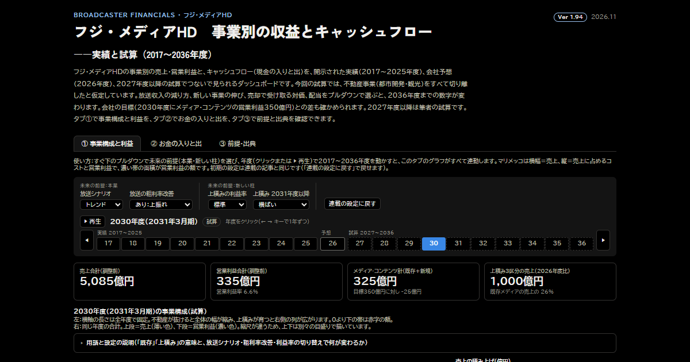

# フジ・メディアHD 事業別の収益とキャッシュフロー――実績と試算（2017〜2036年度）

- **公開URL**: https://naohisastry.github.io/broadcaster-financials-fuji-media-hd/



フジ・メディアHDの事業別の売上・営業利益と、キャッシュフロー（現金の入りと出）を、開示された実績（2017〜2025年度）、会社予想（2026年度）、2027年度以降の試算でつないで見られるダッシュボードです。今回の試算では、不動産事業（都市開発・観光）をすべて切り離したと仮定しています。放送収入の減り方、新しい事業の伸び、売却で受け取る対価、配当をプルダウンで選ぶと、2036年度までの数字が変わります。会社の目標（2030年度にメディア・コンテンツの営業利益350億円）との差も確かめられます。2027年度以降は筆者の試算です。タブ①で事業構成と利益を、タブ②でお金の入りと出を、タブ③で前提と出典を確認できます（**Ver 1.97**）。

画面右上の「日本語／English」で英語表示に切り替えられます（英語版の直接リンク：`?lang=en` を付ける。例 `https://naohisastry.github.io/broadcaster-financials-fuji-media-hd/?lang=en#tab2-total`）。

### 📁 フォルダ構成
```
broadcaster-financials-fuji-media-hd/
├── broadcaster-financials-fuji-media-hd-v1.97.html  # ダッシュボード本体（Ver 1.97 正本）
├── index.html                                        # ルートエイリアス（Ver 1.97 同期）
├── i18n_core_v1.1.js                                 # 日英切り替えの仕組み（英語表示のときだけ置き換え）
├── i18n_en_fuji_v1.0.js                              # 英語の辞書と換算規則（¥bn・FY表記、グラフの値の換算）
├── data/                                             # 構造化データセット
├── social-preview.png                                # OGP標準画像（1200×630px）
├── sitemap.xml                                       # サイトマップ
├── README.md                                         # 本文書
├── CHANGELOG.md                                      # 更新履歴
├── LICENSE                                           # MITライセンス（コード）
├── LICENSE-CONTENT.md                                # CC BY 4.0ライセンス（文章・データ・図表）
└── .gitignore                                        # Git除外設定
```

---

## 🇬🇧 English

**Fuji Media Holdings: Segment Earnings and Cash Flow — Actuals and Projections (FY3/2018–FY3/2037)**

This dashboard links Fuji Media Holdings' revenue and operating profit by segment, and its consolidated cash flow, across disclosed actuals (FY3/2018–FY3/2026), the company forecast (FY3/2027) and the author's estimates from FY3/2028 onward. The estimates assume the real estate business (Urban Development, Hotels & Resorts) is fully separated at the end of FY3/2027. Drop-downs for the broadcasting scenario, gross margin improvement, growth add-ons, sale proceeds and dividend change the figures through FY3/2037.

- **Live (English):** https://naohisastry.github.io/broadcaster-financials-fuji-media-hd/?lang=en
- Switch language with **日本語 / English** at the top right. The choice is remembered on your device; `?lang=en` or `?lang=ja` in the URL always takes priority. Links such as `#tab1-trend`, `#tab2-total` and `#tab2-cash` work in both languages.

| Tab | What it shows |
|---|---|
| ① Business Mix & Profit | Marimekko of revenue and margin by segment, revenue and profit stacks, operating profit over time vs the Group Vision target (¥35bn in FY3/2031) |
| ② Cash In & Out | Sankey of consolidated cash in and out by year or period, operating CF vs investment and shareholder returns, year-end cash vs minimum cash |
| ③ Assumptions & Sources | Every assumption with its label (Confirmed / Company forecast / Assumption / Inferred) and source |

**Conventions in the English version**

- Amounts are in **¥bn** (the Japanese version uses ¥100m units; values are converted by ÷10 without rounding). Some table cells keep the original ¥m where labelled.
- Fiscal years are shown as **FY3/2027** = the Japanese "2026年度" (year ending March 2027). Group Vision's "FY2030" target therefore appears as FY3/2031.
- Segment names follow the company's official English disclosures (Media & Content; Urban Development, Hotels & Resorts).
- Figures from FY3/2028 onward are the author's estimates, not company forecasts. Translations of Japanese quotes are the author's.

### 注意事項
- **2027年度以降の数字は筆者の試算です。不動産事業をすべて切り離したと仮定しており、会社の発表や予想ではありません。**

### データの出典
- フジ・メディア・ホールディングス 有価証券報告書（セグメント情報、連結キャッシュ・フロー計算書）
- 決算説明資料
- Group Vision 2026-2030
- ※各指標の算出定義や詳細な前提条件は、ダッシュボード内の「タブ③ 前提と出典」をご確認ください。

---

## 関連プロジェクト・分析記事

- [note マガジン（Naohisa Hashimoto）](https://note.com/naohisas)
- [放送事業者セグメント分解ダッシュボード](https://naohisastry.github.io/broadcaster-segment-cutline-dashboard/)

---

## ライセンス / License

- **コード（HTML / CSS / JavaScript）**: [MIT License](LICENSE)
- **文章・データ・図表**: [Creative Commons Attribution 4.0 International (CC BY 4.0)](LICENSE-CONTENT.md)
  - 企画・分析・データ設計：Naohisa Hashimoto
